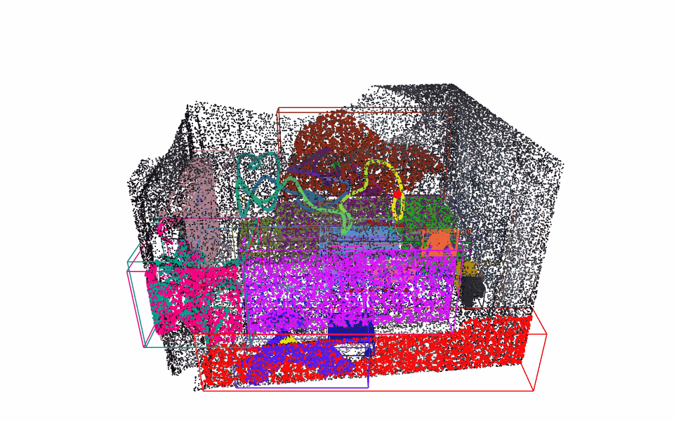

# SuperMap

"SuperMap: A Spatio-Temporal SLAM System for Visual-Language Navigation" (RSS 2026, [arXiv 2608.22896](https://arxiv.org/abs/2608.22896))의 Python 재구현.

*English (default): [README.md](README.md)*

이 저장소는 SuperMap 논문만 보고 독립적으로 작성한 **비공식** 재구현이며 공식 코드는 사용하지 않았다. \
알고리즘과 논문의 모든 저작권은 원저자(Shibo Zhao, Guofei Chen 외, Carnegie Mellon University Robotics Institute)에게 있다. \
공식 구현은 [github.com/superxslam/SuperMap](https://github.com/superxslam/SuperMap), 프로젝트 페이지는 [superodometry.com/supermap](https://superodometry.com/supermap)이다. \
구현은 하네스 엔지니어링 방식으로 진행했다. \
논문에서 뽑은 요구사항 명세를 기준으로 LLM 에이전트가 구현·검증·보완을 반복하고, 모든 요구사항에 대한 논문 기반 테스트와 자동 게이트가 완료를 판정하는 구조였다. \
저장소에는 그 결과물인 파이프라인 코드와 문서만 올렸다. \
ScanNet v2 validation 40개 장면과 ScanNet으로 만든 합성 변화 시퀀스에서 평가했고, 논문이 제시한 모듈 주기로 실시간 동작한다. \
구현 세부, 파라미터, 실험, 각 기본값의 근거는 [docs/IMPLEMENTATION.ko.md](docs/IMPLEMENTATION.ko.md)에 있다.

## 목차

1. [알고리즘](#알고리즘)
2. [논문 대비 결과](#논문-대비-결과)
3. [논문과의 차이](#논문과의-차이)
4. [설치](#설치)
5. [사용법](#사용법)
6. [저장소 구조](#저장소-구조)
7. [문서](#문서)
8. [인용](#인용)
9. [사용한 데이터셋과 모델](#사용한-데이터셋과-모델)
10. [라이선스](#라이선스)
11. [TODO](#todo)

## 알고리즘

논문 보충자료의 Algorithm 1 순서대로 프레임을 처리하고, Sec. V-H의 주기(pose 10 Hz, segmentation 1 Hz, mapping 3 Hz, scene graph 5 Hz)로 네 모듈이 비동기로 돈다. \
층별 처리 흐름과 각 단계(Eq. 3-10)의 구현 설명은 [docs/IMPLEMENTATION.ko.md의 1절](docs/IMPLEMENTATION.ko.md#1-알고리즘)에 있다.

## 논문 대비 결과

논문은 장면 목록, prompt 목록, GT 프로토콜을 공개하지 않았다. \
따라서 아래 수치는 같은 데이터셋, 같은 지표의 비교이지 동일 조건의 재현이 아니다. pose는 데이터셋이 제공하고(LiDAR-관성 오도메트리 없음), GPU는 RTX PRO 6000이다(논문: RTX 4090 Laptop).

### 클래스 수준 segmentation (ScanNet v2, validation 40개 장면, 논문 Table II)

예측 점은 r = 0.05 m 이내 가장 가까운 GT vertex의 라벨을 받는다. \
값은 장면 평균이다.

| | mIoU | f-mIoU | Acc |
|---|---|---|---|
| 논문, 배경 제외 | 27.4 | 43.5 | 55.5 |
| **본 구현, 배경 제외** | **59.4** | **59.9** | **62.8** |
| 논문, 배경 포함 | 22.6 | 29.1 | 33.0 |
| **본 구현, 배경 포함** | **55.6** | **59.0** | **64.0** |

### 인스턴스 AP (3D axis-aligned 박스 IoU, 논문 Table III 클래스; AP50 / AP25)

| 클래스 | 논문 | 본 구현 |
|---|---|---|
| chair | 63.8 / 74.7 | 54.6 / 76.6 |
| window | 42.2 / 67.9 | 27.7 / 59.0 |
| refrigerator | 62.5 / 62.5 | 26.0 / 57.3 |
| sofa | 33.4 / 83.4 | 86.4 / 86.4 |
| door | 10.0 / 25.0 | 29.7 / 42.7 |

평가한 17개 클래스 전체에서 mAP25 61.3, mAP50 42.9이며, 장면당 활성 인스턴스는 46개(GT 객체 15개)다. \
남은 격차는 다음과 같다. window는 평면이라 벽과 병합되기 쉽고, refrigerator는 8개 장면에만 나와 한 번의 실패가 수치를 크게 흔들며, desk는 검출기가 desk에서 "table" 구문에 더 높은 점수를 주고 클래스 무관 NMS가 객체당 박스 하나만 남기므로 0이다.

### 변화 검출 (논문 Table IV)

논문은 로봇에서 실제 객체 6개를 평가한다. \
본 구현의 데이터는 합성 ScanNet 시퀀스 58개다. \
객체 29개를 각각 제거하거나 추가하고, 객체 픽셀은 GT mesh에서 렌더링한 배경으로 대체한다. strict 매칭은 3D IoU > 0.1, centroid 거리 < 0.3 m, 같은 라벨을 요구한다.

| | 검출 recall | 변화 recall |
|---|---|---|
| 논문 (실제 객체 6개) | 0.26 - 1.00 | 0.62 - 1.00 |
| 본 구현, 추가된 객체 | 0.51 | 0.64 |
| 본 구현, 제거된 객체 | 0.51 | 0.46 |

제거는 좁은 RGB-D 재방문에서 옛 위치가 조각으로만 보이기 때문에 더 어렵다.

### 실행 시간 (논문 Sec. V-H)

Replica office0, 2000 프레임: 200 s 분량의 데이터를 100.2 s에 처리했다.

| 모듈 | 주기 (ms) | 평균 / p95 / 최대 지연 (ms) |
|---|---|---|
| segmentation | 1000 | 189.5 / 259.8 / 330.0 |
| mapping | 333 | 64.6 / 77.9 / 128.2 |
| scene graph | 200 | 0.6 / 0.8 / 1.1 |
| pose | 100 | 0.1 / 0.1 / 0.7 |

모든 모듈이 논문의 주기 안에 들어온다. \
GPU가 논문보다 강하므로 이 지연 값은 낙관적이다.

## 논문과의 차이

- **Pose 출처.** SuperOdometry(LiDAR-IMU, ROS) 대신 `PoseProvider` 인터페이스로 데이터셋 pose를 쓴다. \
  Eq. (3)의 extrinsic 합성은 구현했다.
- **Depth 출처.** LiDAR가 아니라 RGB-D 카메라 depth를 쓴다.
- **모델.** GroundingDINO-base와 SAM2.1-hiera-small을 쓴다. \
  논문의 prompt 목록이 공개되지 않아 prompt 목록은 ScanNet 벤치마크 19개 클래스에 alias 몇 개를 더한 것이다.
- **타임스탬프.** 모듈 주기를 재현하기 위해 데이터셋 프레임 레이트로부터 시뮬레이션한다.
- **VLM.** 백엔드는 교체 가능하다(Gemini flash 계열, 모델이 더 이상 제공되지 않으면 대체). \
  직렬화와 답 파서는 결정론적이다.
- **논문이 열어 둔 세부** 중 이 구현이 채운 것: 검출 박스에 대한 클래스 무관 NMS, 들어올리기 전의 depth-edge/depth-outlier 필터와 마스크 침식, 기존 인스턴스 안에 점이 들어가는 새 track의 흡수, 클래스를 반영한 첫 연관, 병합 후 인스턴스의 최대 연결 성분 유지, 제거를 동반하는 객체 수준 존재 log-odds, 그리고 모든 수치 임계값(Eq. 8, 9, 10 확률, scene graph gamma와 delta, ByteTrack 임계값). \
  각 선택의 측정은 [docs/IMPLEMENTATION.ko.md](docs/IMPLEMENTATION.ko.md)에 있다.
- **평가.** 논문의 로봇 실험 대신 ScanNet과 합성 변화 시퀀스로 평가한다. \
  실제 로봇/내비게이션 스택은 없다.

## 설치

환경은 uv, Python 3.11, torch cu128을 쓴다(sm_120 GPU는 torch 2.7 이상 필요). \
모든 실행은 `.venv/bin/python`으로 한다.

```bash
uv venv .venv --python 3.11
uv pip install --python .venv/bin/python -r requirements.txt
```

- **모델.** 검출기: Grounding DINO base, [IDEA-Research/grounding-dino-base](https://huggingface.co/IDEA-Research/grounding-dino-base). \
  분할기: SAM 2.1 Hiera-S, [facebook/sam2.1-hiera-small](https://huggingface.co/facebook/sam2.1-hiera-small). \
  설정은 Hugging Face 캐시에서 불러오므로(`local_files_only: true`) 처음 한 번 받아 둔다:

  ```bash
  .venv/bin/hf download IDEA-Research/grounding-dino-base
  .venv/bin/hf download facebook/sam2.1-hiera-small
  ```

- **데이터.** 데이터셋은 저장소에 포함하거나 재배포하지 않는다. \
  Replica RGB-D는 NICE-SLAM 형식([Replica.zip](https://cvg-data.inf.ethz.ch/nice-slam/data/Replica.zip))을 `data/replica/<scene>/`에 둔다. \
  ScanNet은 [이용약관](http://www.scan-net.org/) 동의가 필요하다. \
  받은 `.sens`는 공식 [SensReader](https://github.com/ScanNet/ScanNet/tree/master/SensReader/python)(`--export_color_images --export_depth_images --export_poses --export_intrinsics`)로 `data/scannet/scans/<scene>/{color,depth,pose,intrinsic}/`에 export한다.
- **VLM (선택).** 저장소 루트의 `.env`에 `GEMINI_API_KEY=...`를 넣는다.

## 사용법

시퀀스 하나 실행:

```bash
.venv/bin/python -m supermap.run --config configs/default.yaml --subset configs/subset_replica_office0.yaml --out outputs/office0
```

subset 파일은 데이터셋, 장면, 프레임 범위를 고른다(`configs/subset_replica_office0.yaml`: Replica office0, 50 프레임). \
이 50 프레임 subset은 파이프라인이 끝까지 도는지 보는 스모크 테스트용이다(약 10초 분량, 인스턴스 9개). \
장면 전체를 돌리려면 `experiments/configs/full_office0_subset.yaml`(office0, 2000 프레임)을 쓴다. \
다른 Replica 장면은 그 파일의 `scene:`만 바꾸고, ScanNet은 `experiments/configs/scannet_subset_template.yaml`을 복사해 장면 이름을 넣는다.

```bash
.venv/bin/python -m supermap.run --config configs/default.yaml \
  --subset experiments/configs/full_office0_subset.yaml --out outputs/office0_full
```

실행 시간(RTX PRO 6000, 기본 설정): Replica 장면 하나 2000 프레임에 약 2분, ScanNet 장면 하나(stride 3, 300~1500 프레임)에 0.5~4분. \
첫 실행에는 모델 로딩이 몇 초 더 걸린다.

출력 폴더의 내용:

| 파일 | 내용 |
|---|---|
| `map_objects.json` | 인스턴스: id, 라벨 분포, 박스, 상태, 존재 |
| `map_points.npz` | 색 입힌 dense map과 인스턴스 점 |
| `graph.json` | 4D scene graph (노드, 공간/시간 엣지) |
| `serialized.txt` | VLM에 보내는 텍스트 직렬화 |
| `run_summary.json` | 프레임 수, 인스턴스 수, 모듈 실행 횟수, 흡수/제거 통계, VLM 상태 |

### 3D 시각화

출력 폴더를 브라우저에서 돌려 볼 수 있는 단일 HTML로 만든다:

```bash
.venv/bin/python scripts/visualize.py outputs/office0   # -> outputs/office0/viz.html
```

dense map, 인스턴스별 점/박스/라벨, 공간 엣지(on/beside/under)와 시간 엣지, VLM 웨이포인트, 카메라 궤적을 보여 주며 범례에서 각각 켜고 끌 수 있다(wall / floor / ceiling 인스턴스는 가구를 가리므로 처음엔 꺼져 있다). \
파일 하나로 완결되어 어떤 브라우저에서도 열린다. 카메라 궤적에는 subset 파일이 필요하다(`--subset`, 기본값은 출력 폴더의 `subset.yaml`, 없으면 `configs/subset_replica_office0.yaml`). \
`--png <path>`를 주면 정적 이미지도 저장한다(`uv pip install kaleido` 후 `.venv/bin/plotly_get_chrome` 필요).



위 그림은 office0 2000 프레임 실행 결과(인스턴스 21개, 공간 엣지 45개, 시간 엣지 59개, 106초)로, 인스턴스 점과 박스, 프레임 순서로 색을 입힌 카메라 궤적, "Where is the chair?"에 대한 VLM 웨이포인트(노란 마름모)를 보여 준다. \
범례가 있는 정지 이미지: [docs/images/office0_full_viz.png](docs/images/office0_full_viz.png).

`configs/default.yaml`에 모든 파라미터가 키마다 주석과 함께 들어 있다. \
각 기본값이 어떤 실험으로 정해졌는지는 [docs/IMPLEMENTATION.ko.md](docs/IMPLEMENTATION.ko.md)에 있다.

## 저장소 구조

```
src/supermap/
  datasets/       Replica, ScanNet 로더
  geometry/       Eq. 3 합성, 역투영, dense map
  perception/     GroundingDINO 검출기, prompt와 alias, SAM2 segmenter
  tracking/       Kalman 상태, ByteTrack, 이웃 객체, Unproject, ObjMerge / MapMerge
  consistency/    Eq. 7-9 점 상태, Eq. 8 log-odds, ObjNegate, 존재 log-odds
  semantics/      Eq. 10 라벨 융합
  graph/          군집화, 술어, 시간 엣지, 직렬화
  vlm/            Gemini 백엔드, <answer> 파서, 웨이포인트
  pipeline.py     프레임별 처리 순서 (Alg. 1)
  scheduler.py    비동기 모듈 주기
  run.py          진입점 (python -m supermap.run)
configs/          default.yaml (전체 파라미터), 예시 subset
docs/             구현 문서
```

## 문서

- [docs/IMPLEMENTATION.ko.md](docs/IMPLEMENTATION.ko.md) (영어: [docs/IMPLEMENTATION.md](docs/IMPLEMENTATION.md)): 어떻게 만들었는가. \
  구현 세부, 파라미터, 실험, 각 기본값의 근거.

## 인용

이 저장소를 쓴다면 원 논문을 인용해 주세요. \
공식 구현과 프로젝트 페이지: [github.com/superxslam/SuperMap](https://github.com/superxslam/SuperMap), [superodometry.com/supermap](https://superodometry.com/supermap).

```bibtex
@inproceedings{supermap2026,
  title     = {SuperMap: A Spatio-Temporal SLAM System for Visual-Language Navigation},
  author    = {Zhao, Shibo and Chen, Guofei and Zhu, Honghao and Li, Zhiheng and Yao, Changwei and Zantout, Nader and Kim, Seungchan and Wang, Wenshan and Zhang, Ji and Scherer, Sebastian},
  booktitle = {Robotics: Science and Systems (RSS)},
  year      = {2026},
  note      = {arXiv:2608.22896},
  url       = {https://arxiv.org/abs/2608.22896}
}
```

## 사용한 데이터셋과 모델

이 구현은 아래 데이터셋과 모델을 사용했다. \
이 저장소를 쓴다면 이들도 함께 인용해 주세요. \
데이터와 모델 가중치는 저장소에 포함하지 않으며, 다운로드 스크립트가 원 배포처에서 받는다.

| | 용도 | 라이선스 / 이용 조건 |
|---|---|---|
| [ScanNet v2](http://www.scan-net.org/) | 주 벤치마크(validation 40개 장면)와 합성 변화 감지 시퀀스 | ScanNet Terms of Use (비상업 연구) |
| [Replica](https://github.com/facebookresearch/Replica-Dataset), [NICE-SLAM](https://github.com/cvg/nice-slam)이 렌더링한 RGB-D | 개발, 스모크 테스트, 실행 시간 측정 | Replica 연구용 라이선스 |
| [Grounding DINO](https://github.com/IDEA-Research/GroundingDINO) (grounding-dino-base) | Open-vocabulary 검출 | Apache-2.0 |
| [SAM 2](https://github.com/facebookresearch/sam2) (sam2.1-hiera-small) | 박스 프롬프트 인스턴스 마스크 | Apache-2.0 |
| [ByteTrack](https://github.com/ifzhang/ByteTrack) | 2단계 연관 (알고리즘만 재구현, 코드 미사용) | MIT |

```bibtex
@inproceedings{dai2017scannet,
  title     = {ScanNet: Richly-annotated 3D Reconstructions of Indoor Scenes},
  author    = {Dai, Angela and Chang, Angel X. and Savva, Manolis and Halber, Maciej and Funkhouser, Thomas and Nie{\ss}ner, Matthias},
  booktitle = {IEEE Conference on Computer Vision and Pattern Recognition (CVPR)},
  year      = {2017}
}

@article{straub2019replica,
  title   = {The {R}eplica Dataset: A Digital Replica of Indoor Spaces},
  author  = {Straub, Julian and Whelan, Thomas and Ma, Lingni and Chen, Yufan and Wijmans, Erik and Green, Simon and Engel, Jakob J. and Mur-Artal, Raul and Ren, Carl and Verma, Shobhit and Clarkson, Anton and Yan, Mingfei and Budge, Brian and Yan, Yajie and Pan, Xiaqing and Yon, June and Zou, Yuyang and Leon, Kimberly and Carter, Nigel and Briales, Jesus and Gillingham, Tyler and Mueggler, Elias and Pesqueira, Luis and Savva, Manolis and Batra, Dhruv and Strasdat, Hauke M. and De Nardi, Renzo and Goesele, Michael and Lovegrove, Steven and Newcombe, Richard},
  journal = {arXiv preprint arXiv:1906.05797},
  year    = {2019}
}

@inproceedings{zhu2022niceslam,
  title     = {NICE-SLAM: Neural Implicit Scalable Encoding for SLAM},
  author    = {Zhu, Zihan and Peng, Songyou and Larsson, Viktor and Xu, Weiwei and Bao, Hujun and Cui, Zhaopeng and Oswald, Martin R. and Pollefeys, Marc},
  booktitle = {IEEE/CVF Conference on Computer Vision and Pattern Recognition (CVPR)},
  year      = {2022}
}

@inproceedings{liu2024groundingdino,
  title     = {Grounding DINO: Marrying DINO with Grounded Pre-Training for Open-Set Object Detection},
  author    = {Liu, Shilong and Zeng, Zhaoyang and Ren, Tianhe and Li, Feng and Zhang, Hao and Yang, Jie and Jiang, Qing and Li, Chunyuan and Yang, Jianwei and Su, Hang and Zhu, Jun and Zhang, Lei},
  booktitle = {European Conference on Computer Vision (ECCV)},
  year      = {2024}
}

@article{ravi2024sam2,
  title   = {SAM 2: Segment Anything in Images and Videos},
  author  = {Ravi, Nikhila and Gabeur, Valentin and Hu, Yuan-Ting and Hu, Ronghang and Ryali, Chaitanya and Ma, Tengyu and Khedr, Haitham and R{\"a}dle, Roman and Rolland, Chloe and Gustafson, Laura and Mintun, Eric and Pan, Junting and Alwala, Kalyan Vasudev and Carion, Nicolas and Wu, Chao-Yuan and Girshick, Ross and Doll{\'a}r, Piotr and Feichtenhofer, Christoph},
  journal = {arXiv preprint arXiv:2408.00714},
  year    = {2024}
}

@inproceedings{zhang2022bytetrack,
  title     = {ByteTrack: Multi-Object Tracking by Associating Every Detection Box},
  author    = {Zhang, Yifu and Sun, Peize and Jiang, Yi and Yu, Dongdong and Weng, Fucheng and Yuan, Zehuan and Luo, Ping and Liu, Wenyu and Wang, Xinggang},
  booktitle = {European Conference on Computer Vision (ECCV)},
  year      = {2022}
}
```

## 라이선스

이 저장소의 코드와 문서는 [MIT 라이선스](LICENSE)를 따른다. \
SuperMap 알고리즘과 논문의 권리는 원저자에게 있으며, 이 라이선스는 이 재구현에만 적용된다.

## TODO

구현이 논문과 벌어져 있는 곳과 범위 밖으로 둔 것. 근거 수치와 진단은 [docs/IMPLEMENTATION.ko.md 9절](docs/IMPLEMENTATION.ko.md#9-한계와-열린-이슈)에 있다.

- [ ] **인스턴스 과분할·혼합.** ScanNet 장면당 활성 인스턴스 46개 vs GT 객체 15개. office0에서도 소파 2개가 인스턴스 3개로, 테이블 1개가 2개로 나뉜다. \
  인스턴스 id가 2D 트랙 id라서 트랙이 끊기면 새 id가 생기고, 재활성화(Eq. 5)와 흡수(D-111)는 이미 본 면에서만 동작한다. 붙어 있는 같은 클래스 물체는 한 검출 박스나 ID 스위치로 섞인다. 3D에서 다시 합치거나 가르는 단계가 없다.
- [ ] **배경이 가구 라벨로 샘.** office0에서 벽+러그가 "table", 블라인드가 "door"로 붙는다. 마스크 정리나 배경 클래스 처리가 필요하다.
- [ ] **desk 클래스 손실.** 클래스 무관 NMS(D-116)가 같은 물체의 "table" 박스 뒤에서 "desk" 박스를 지워 desk AP50이 0이다 (I-14-2).
- [ ] **얇은 평면 물체 AP.** window AP50 27.7 (논문 42.2), refrigerator 26.0.
- [ ] **변화 검출의 제거 recall.** 좁은 시야의 RGB-D 재방문에서 제거된 객체 29개 중 14개만 REMOVED에 도달하고 중앙값 354프레임이 걸린다.
- [ ] **정적 장면 오제거.** 객체 존재 log-odds(D-113)가 작은 조각을 장면당 17~24개 지운다 (I-9-4).
- [ ] **SuperOdometry / LiDAR 입력.** 지금은 데이터셋 GT pose와 RGB-D depth만 쓴다. `PoseProvider` 구현을 추가하면 된다.
